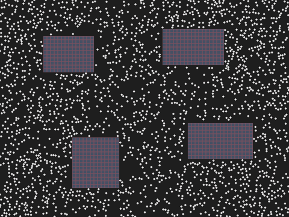

# NPC City Sim



Python ile sıfırdan yazılmış 2D şehir mikro-simülasyonu. Binlerce ajan gezer, birbirine çarpar, "silah sesi" duyunca siper alır ya da kaçar. Oyun motoru yoktur; yalnızca NumPy, Numba ve Pygame (çizim için) kullanılır.

Açık dünya oyunlarındaki "yaşayan şehir" hissinden ilham alan, keyfi bir portföy projesidir. Herhangi bir oyun stüdyosuyla bağlantısı yoktur.

## Özellikler

- **Spatial hash grid** ile ~O(N) çarpışma tespiti (brute-force O(N²) referans sürümle kıyaslamalı)
- **Maliyet tabanlı davranış seçimi:** ajanlar silah sesini duyunca "siper al" ve "kaç" planlarını karşılaştırıp en ucuzunu seçer
- Dikdörtgen binalarla çarpışma ve siper noktası hesabı
- Numba (`@njit`) ile derlenmiş çekirdek döngüler, veri NumPy dizilerinde
- Otomatik benchmark scripti ve tek tuşla GIF kaydı

## Kurulum ve çalıştırma

Python 3.10+ önerilir (3.13 ile test edildi).

```
git clone https://github.com/Sevval12345/npc-city-sim-gta.git
cd npc-city-sim-gta
python -m venv .venv
.venv\Scripts\activate        # Mac/Linux: source .venv/bin/activate
pip install -r requirements.txt
python main.py
```

İlk açılışta Numba kodu derlediği için 1-2 saniye beklemek normaldir.

## Kontroller

| Girdi | İşlev |
|---|---|
| Sol tık | O noktada silah sesi oluşturur |
| `R` | GIF kaydını başlatır / durdurur (`docs/demo.gif`) |

Renkler: beyaz = gezinti, kırmızı = kaçış, turuncu = sipere koşu, mavi = saklanma.
Silah sesinden sonra sarı kareler hesaplanan siper noktalarını kısa süre gösterir.

## NPC davranışı

Sesi duyan her ajan iki planı karşılaştırır ve en düşük maliyetliyi seçer:

| Aksiyon | Ön koşul | Maliyet |
|---|---|---|
| Siper al | Silaha göre binanın arka tarafında bir nokta var ve ajandan oraya giden yol başka bir bina tarafından kesilmiyor | Ulaşma süresi (mesafe / hız) |
| Kaç | Yok | Sabit ceza |

Siperdeki ajan bir süre saklanır, sonra yeniden gezintiye döner.

Bu, hedef + ön koşul + maliyet mantığını kullanan küçük bir GOAP benzeri yapıdır. Tam bir planlayıcı (aksiyon zinciri araması) değildir.

## Çarpışma benchmark'ı

Simülasyon adımı süresi (ms, medyan), 800x600 alan, yarıçap 3 px. Düşük olan iyi.
Ölçüm `benchmark.py` ile otomatik yapılır (çizim dahil değil).

| Ajan | Brute-force O(N²) (ms) | Spatial hash grid (ms) | Hızlanma |
|---|---|---|---|
| 1.000 | 0,64 | 0,13 | 4,9x |
| 2.000 | 2,24 | 0,22 | 10,1x |
| 5.000 | 13,73 | 0,80 | 17,1x |
| 10.000 | 54,16 | 1,77 | 30,6x |
| 20.000 | 221,13 | 6,20 | 35,7x |

Brute-force, ajan sayısı ikiye katlanınca yaklaşık 4 kat yavaşlar (O(N²)). Grid çok daha yavaş büyür. En yoğun durumda (20.000 ajan) hücre başına düşen ajan arttığı için grid süresi doğrusaldan biraz hızlı artar, ama fark yine de açılır.

Test makinesi: AMD işlemci, Python 3.13, Windows. Kendi makinende yeniden üretmek için:

```
python benchmark.py
```

## Proje yapısı

```
main.py          Ana döngü, çizim, girdi, GIF kaydı
sim.py           Çarpışma: brute-force ve spatial hash grid (Numba)
behavior.py      Silah sesi, siper/kaçış seçimi, durum makinesi, bina çarpışması
benchmark.py     Otomatik performans ölçümü
docs/demo.gif    README'deki demo
```

## Bilinen sınırlamalar

- Yol bulma (pathfinding) yok; ajanlar hedefe düz çizgiyle gider. Yol bina tarafından kesiliyorsa siper yerine kaçmayı seçerler.
- Ajanlar arası çarpışma basit bir itme modeliyle çözülür, fiziksel olarak hassas değildir.
- Çizim Pygame ile CPU üzerinde yapılır; çok yüksek ajan sayılarında FPS'i çizim sınırlar, simülasyon değil.

## Yol haritası

- [ ] A* ile yol bulma (binaları dolanarak siper noktasına gitme)
- [ ] Yollar ve araç trafiği
- [ ] `pytest` ile birim testleri
- [ ] C++ portu ve karşılaştırma
